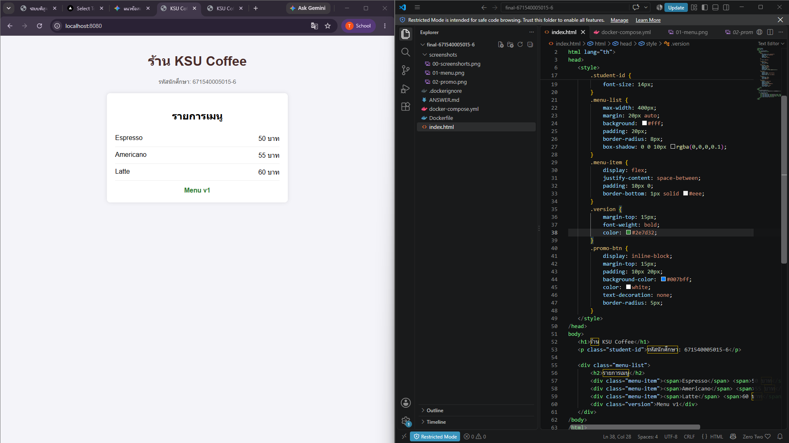
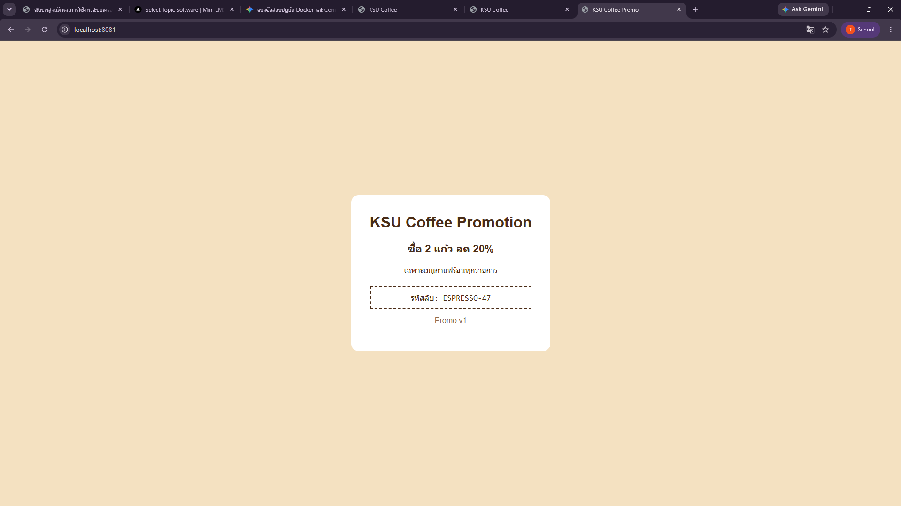

# ANSWER — นาย <ธรรมรัตน์  ไพลสาลี> 671540005015-6

## Part A — ข้อมูลจาก image kamthornsa/ksu-promo:1.0

| คำถาม | คำตอบ | คำสั่งที่ใช้ |
| --- | --- | --- |
| Port | 3000 | `docker image inspect kamthornsa/ksu-promo:1.0` |
| CMD | `["nginx", "-g", "daemon off;"]` | `docker image inspect kamthornsa/ksu-promo:1.0` |
| Base image | `nginx:alpine` | `docker history kamthornsa/ksu-promo:1.0` |

## Part B — รหัสลับบนหน้าโปรโมชั่น

<นำรหัสลับที่เห็นบนหน้า http://localhost:8081 มาใส่ตรงนี้>ESPRESSO-47

## Part C — คำถาม

1. หน้าโปรโมชั่นถูก Build เป็น Docker Image สำเร็จรูปเรียบร้อยแล้ว จึงไม่สามารถแก้ไขโค้ดด้านในได้โดยตรง ต่างจากหน้าเมนูที่เรามีไฟล์ Source Code อยู่บนเครื่องตัวเอง จึงแก้ไขและ Rebuild ใหม่ได้
2. หากไม่ระบุ Tag ตัว Docker จะดึง Tag `latest` มาใช้แทน ซึ่งอาจทำให้ได้ Image เวอร์ชันล่าสุดที่ไม่ใช่ 1.0 หรือหากไม่มี Tag latest บน registry คำสั่งจะแจ้ง Error หา Image ไม่พบ
3. ตัวเลขฝั่งซ้าย (8081) คือ Host Port บนเครื่องเรา ส่วนตัวเลขฝั่งขวา (3000) คือ Container Port ที่แอปข้างใน Container เปิดรอไว้ ฝั่งขวาไม่ใช่ 80 เพราะ Image นี้ถูกเขียนขึ้นมาให้ EXPOSE อยู่ที่ port 3000
4. หน้าเว็บจะไม่เปลี่ยน เพราะ Docker Compose จะใช้ Image ตัวเดิมที่ถูก build ไว้ก่อนหน้า คำสั่งที่ถูกต้องคือ `docker compose up -d --build` เพื่อบังคับให้ทำการ Build Image ใหม่ตามไฟล์ที่ถูกแก้ไข
5. ลิงก์ใช้ URL `http://localhost:8081` เพราะลิงก์ถูกคลิกและทำงานจากฝั่ง Web Browser (Client) บนเครื่องโฮสต์ ส่วน `http://promo:3000` เป็นการอ้างอิง DNS ภายใน Docker Network สำหรับ Service คุยกันเองภายในเท่านั้น

## ภาพหน้าจอ

